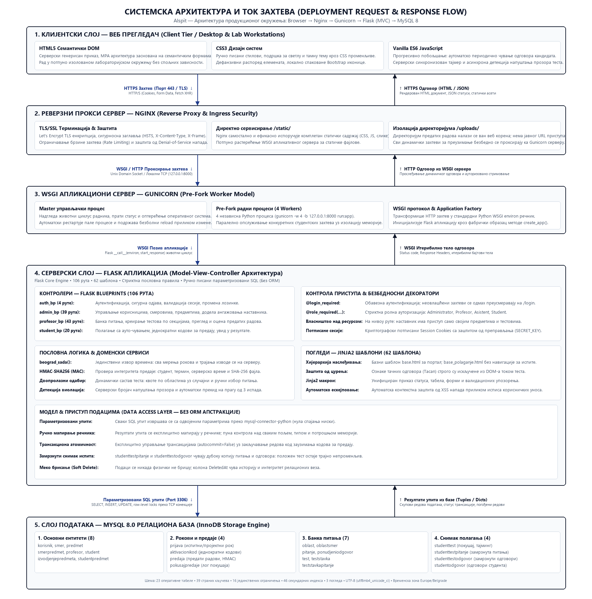
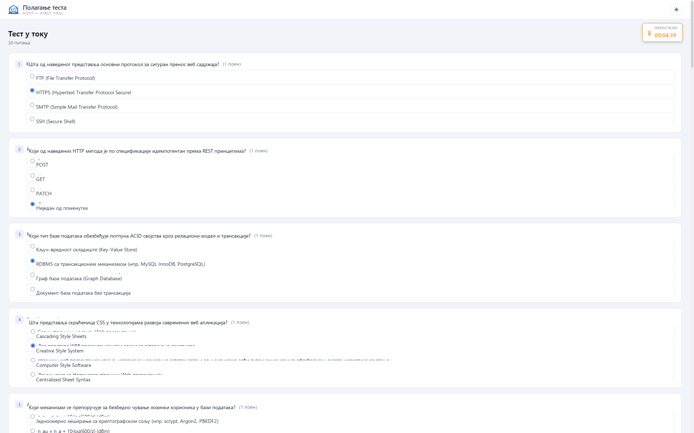
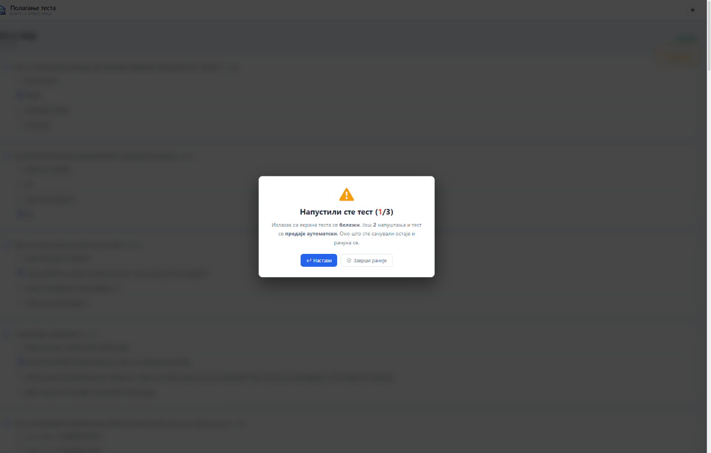
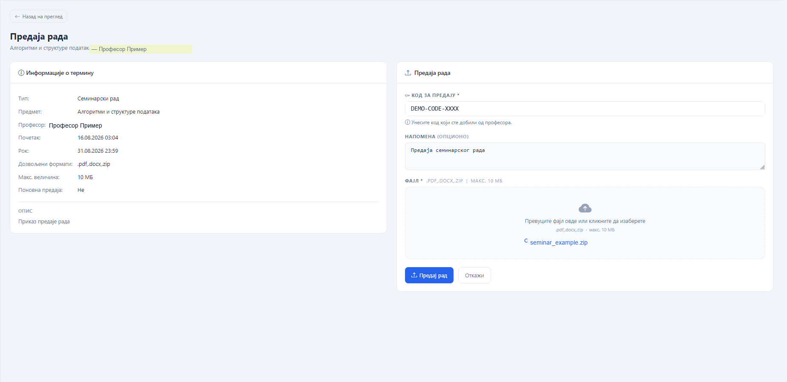
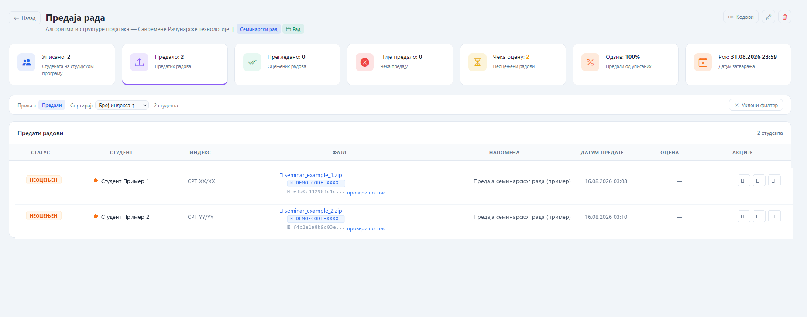

# AIspit — Academic Examination & Assignment Management Platform

<p align="center">
  
</p>

<p align="center">
  <strong>Featured Software Engineering Portfolio Project</strong><br>
  <em>A secure, multi-tier web platform unifying online examination integrity, dynamic question banking, and tamper-evident assignment verification.</em>
</p>

<p align="center">
  <a href="#1-project-overview">Overview</a> •
  <a href="#5-system-architecture">Architecture</a> •
  <a href="#7-database-design">Database Design</a> •
  <a href="#9-examination-integrity--anti-cheating-mechanisms">Exam Integrity</a> •
  <a href="#10-assignment-submission-system">Assignment Submissions</a> •
  <a href="#12-testing-and-quality-assurance">Testing & QA (574 Checks)</a> •
  <a href="#13-ai-assisted-engineering-analysis">AI-Assisted Engineering</a> •
  <a href="#15-live-application-deployment">Live Demo</a>
</p>

> 📌 **Featured Portfolio Showcase:** AIspit serves as the primary software engineering portfolio project on my GitHub profile. This repository is an in-depth, documentation-only engineering presentation detailing the system architecture, relational database design, application security mechanisms, testing methodology, and development telemetry. Proprietary application source code is withheld in accordance with institutional policy.

---

## 1. Project Overview

**AIspit** (*Sistem za elektronsku predaju radova i organizaciju onlajn ispita*) is a comprehensive academic software solution engineered to modernize and unify two historically fragmented workflows in higher education:

1. **Continuous Project & Lab Assignment Submissions:** Eliminating unverified email attachments, physical USB drives, and third-party file storage by providing a centralized repository with MIME magic-byte validation, atomic activation codes, and cryptographic HMAC-SHA256 tamper-evident submission integrity verification.
2. **Online Knowledge Testing & Examination Integrity:** Administering secure online exams via dynamic section-based question selection, randomized candidate variants, server-enforced time boundaries, real-time answer autosaving, and anti-cheating browser viewport monitoring.

### Core Engineering Competencies Demonstrated
As the flagship engineering project of my portfolio, AIspit demonstrates practical experience across the full software engineering lifecycle:
- **Full-Stack Architecture:** Classical 3-tier Multi-Page Application (MPA) with clean Model-View-Controller (MVC) separation and progressive client-side enhancement.
- **Backend Engineering:** Modular Python 3.10+ and Flask core engine spanning 106 endpoints organized across 4 role-based Blueprints.
- **Relational Database Design:** 23 operational tables, 39 foreign keys, 16 unique constraints, 46 secondary indexes, and safety-critical snapshot denormalization in MySQL 8 (InnoDB).
- **Frontend Development:** Responsive semantic HTML5, hand-crafted CSS3 variables (light/dark themes), Bootstrap Icons, and vanilla ES6 JavaScript (zero heavy client dependencies).
- **Access Control & Identity:** 3-tier defensive security incorporating `@login_required`, role-based authorization (Admin, Professor, Assistant, Student), and granular resource tenant ownership checks.
- **Data Integrity & Verification:** Atomic single-use submission tokens, content-based MIME magic-byte validation, and keyed HMAC-SHA256 tamper-evident verification.
- **Testing & Quality Assurance:** Rigorous QA methodology documenting 574 automated checks (547 Flask WSGI integration tests and 27 Playwright E2E browser tests) across 26 suites.
- **Production Deployment:** High-availability deployment topology on institutional servers utilizing Nginx reverse proxy, Gunicorn pre-fork WSGI daemon, and TLS/SSL termination.

Originally conceptualized and developed as an undergraduate final thesis at the **Academy of Technical and Educational Vocational Studies in Niš (ATVSS Niš)**, the platform is currently deployed and active on institutional infrastructure:

- **Live Production URL:** [https://aispit.vtsappsteam.edu.rs/login](https://aispit.vtsappsteam.edu.rs/login)

---

## 2. Problem Statement

In the absence of a purpose-built academic system, higher education institutions struggle with significant operational and integrity challenges:

- **Dispersed Submissions:** Student coursework is submitted via disparate channels (email, USB, cloud drives), scattering files across professors' personal accounts with zero centralized institutional records.
- **Untrusted Submission Timestamps:** Email header timestamps can be disputed or spoofed; establishing whether a student met a strict deadline becomes a matter of interpersonal negotiation rather than verifiable system records.
- **Vulnerabilities in Traditional Online Testing:** Commercial learning management systems (LMS) often suffer from client-side time manipulation vulnerabilities, answer leakage in client DOM/JavaScript trees, and post-exam grading disputes arising when questions are modified in the question bank after an exam was completed.
- **Grading Inefficiencies:** Manual paper-based evaluations for large cohorts consume dozens of faculty hours that would otherwise be dedicated to teaching and mentorship.

---

## 3. Project Objectives

- **Relational Rigor Without ORM:** Implement direct, hand-crafted, parameterized SQL queries over **MySQL 8 (InnoDB)**, ensuring complete transaction control, fine-grained locking, and avoiding leaky abstraction overhead.
- **Offline / Laboratory Self-Containment:** Ensure that the platform functions in computer examination laboratories without internet connectivity, avoiding external CDN dependencies for CSS, scripts, or icons.
- **Deterministic Server-Enforced Logic:** Treat the client browser as strictly untrusted; all time boundaries, grading calculations, attempt validations, and violation detections are determined on the server.
- **Frozen Immutable History:** Implement a denormalized snapshot architecture where every exam attempt preserves the exact text, options, and point values presented to the student, ensuring historical non-tampering regardless of future question bank revisions.
- **Defensive Engineering & Rigorous Verification:** Documented comprehensive automated test harness (**574 automated checks**) validated via mutation testing ("Negative Proof of Test Validity").

---

## 4. Key Functional Capabilities

| Feature Domain | Capabilities & Engineering Highlights |
| :--- | :--- |
| **Institutional Administration** | Hierarchical curriculum management: study programs (`Smer`), courses (`Predmet`), teaching assignments (`IzvodjenjePredmeta`), and batch student CSV/Excel onboarding with in-memory credential derivation. |
| **Question Bank Management** | Topic-based categorization (`Oblast`), program-specific scoping, support for closed-ended (automatic grading) and open-ended (faculty grading) items, with inline image attachment support. |
| **Dynamic Exam Builder** | Sectional composition (`TestStavka`): faculty specify topic quotas, explicit manual assignments, or randomized extraction. Guarantees zero duplicate questions across sections via a deterministic two-pass algorithm. |
| **Exam Execution Engine** | Client-side DOM scrubbing of answer keys, background autosave (debounced for text, instant for choices), independent shuffling of question, choice, and section orders. |
| **Anti-Cheating Monitoring** | Viewport visibility, blur, and fullscreen exit tracking. Increments server-side violation counters with candidate warnings, automatically terminating the exam at threshold 3 as a deterrent against unauthorized browser navigation. |
| **Assignment Gating & Codes** | Gated submissions via single-use or shared activation codes with atomic SQL state consumption (`UPDATE ... WHERE Iskoriscen = 0`), expiry enforcement, and brute-force rate limiting (5 attempts/min). |
| **File Verification & HMAC** | Binary MIME magic-byte validation (PDF, ZIP, DOCX), UUID disk sanitization outside web root, and tamper-evident HMAC-SHA256 message authentication code (MAC) verification over file digests and timestamps. |
| **Evaluation & Grading** | Instant automatic scoring of objective questions; dedicated review interface for subjective responses; committee point adjustments; and auditable attempt cancellations. |

---

## 5. System Architecture

AIspit implements a classical **3-Tier Layered Architecture** following the **Model-View-Controller (MVC)** architectural pattern within a **Multi-Page Application (MPA)** paradigm:

<p align="center">
  
</p>

### 5.1 Architectural Layers

1. **Client Tier (Presentation & Interaction):**
   - Pure semantic HTML5 rendered server-side via Jinja2.
   - Hand-crafted CSS3 (~1,200 lines) utilizing CSS custom properties for instant light/dark theme transitions without JavaScript style mutation.
   - Vanilla ES6 JavaScript for progressive enhancement (autosaving, countdown rendering, violation event dispatch). Zero client-side packaging step (no Webpack, Vite, or npm dependencies).
2. **Application Tier (Business Logic & Controllers):**
   - **Flask 3.x** core engine initialized via the **Application Factory** pattern (`create_app()`).
   - Modularized into **4 Blueprints** hosting **106 distinct routes** (reconciled with thesis Table 4.3.1: 43 professor, 39 admin, 20 student, 4 auth).
   - **3-Tier Access Control:** Authentication (`@login_required`), Role-Based Authorization (`@role_required`), and In-Route Resource Ownership Verification (IDOR prevention).
   - Single Source of Truth for Time (`beograd_sada()`): Naive Belgrade wall-clock time (`Europe/Belgrade`), synchronized per-connection with MySQL session timezones.
3. **Data Tier (Relational Storage & Transactions):**
   - **MySQL 8.0 (InnoDB)** ensuring ACID compliance, strict foreign key constraints, and row-level locking.
   - **Zero ORM Overhead:** Direct execution via `mysql-connector-python` using parameterized SQL prepared statements.
   - Universal soft deletion (`DeletedAt IS NULL`) across all 23 operational tables.

> 📖 *For a deep dive into module relationships, request lifecycles, and design patterns, see [docs/ARCHITECTURE.md](docs/ARCHITECTURE.md).*

---

## 6. Technology Stack

Every technology in AIspit was selected based on strict engineering justification rather than framework inertia:

```
+-------------------------------------------------------------------------+
| BACKEND & APPLICATION ENGINE                                            |
| - Python 3.10+ (Standard Library: hmac, hashlib, uuid, zoneinfo)        |
| - Flask 3.x (Micro-framework: routing, sessions, blueprint architecture)|
| - Werkzeug (Password hashing via salted scrypt/pbkdf2, WSGI utilities) |
| - tzdata (Deterministic timezone conversion for Europe/Belgrade)        |
+-------------------------------------------------------------------------+
| DATABASE & PERSISTENCE                                                  |
| - MySQL 8.0 Community Server (InnoDB Storage Engine)                   |
| - mysql-connector-python (Official Oracle driver, parameterized SQL)    |
+-------------------------------------------------------------------------+
| PRESENTATION & USER EXPERIENCE                                          |
| - Jinja2 (Hierarchical server-side template inheritance, 62 templates)  |
| - Hand-Crafted CSS3 (CSS Custom Properties, zero CSS frameworks)        |
| - Vanilla ES6 JavaScript (No frameworks, no build step, fetch API)     |
| - Bootstrap Icons (Local self-contained SVG/font package)               |
+-------------------------------------------------------------------------+
| TESTING & QUALITY ASSURANCE (Documented Thesis Records)                 |
| - Flask Test Client (547 in-process WSGI integration checks)            |
| - Headless Browser Automation (27 real-browser end-to-end tests)        |
| - Mutation Testing Harness ("Negative Proof" fault-injection validation)|
+-------------------------------------------------------------------------+
| DEPLOYMENT & INFRASTRUCTURE                                             |
| - Nginx (Reverse proxy, SSL/TLS termination, upload path segregation)   |
| - Gunicorn (WSGI HTTP pre-fork worker daemon)                           |
+-------------------------------------------------------------------------+
| AI-ASSISTED DEVELOPMENT TOOLS                                           |
| - Claude (Conversational architectural trade-off deliberation)          |
| - Claude Code (In-environment CLI agent for implementation & tests)     |
| - Gemini & ChatGPT (Visual identity, vector logos, dark-theme contrast) |
+-------------------------------------------------------------------------+
```

---

## 7. Database Design

The relational database schema is modeled in **Third Normal Form (3NF)** with an intentional, safety-critical denormalization for candidate exam attempts:

- **23 Operational Tables** and 3 legacy read-only views.
- **39 Foreign Key Constraints** enforcing referential integrity.
- **16 Unique Constraints** preventing duplicate student registrations, multi-attempt exams, and duplicate activations.
- **46 Secondary Indexes** optimized for foreign key lookups and status filtering.

<p align="center">
  
</p>

### 7.1 Schema Subsystem Breakdown

1. **Core Academic Model:** `korisnik`, `smer`, `predmet`, `smerpredmet`, `profesor`, `student`, `izvodjenjepredmeta`, `studentpredmet`.
2. **Assignment Submissions:** `prijava`, `aktivacionikod`, `predaja`, `pokusajpredaje`.
3. **Question Bank & Tests:** `oblast`, `oblastsmer`, `pitanje`, `ponudjeniodgovor`, `test`, `teststavka`, `teststavkapitanje`.
4. **Exam Execution & Snapshots:** `studenttest`, `studenttestpitanje`, `studenttestodgovor`, `studentodgovor`.

### 7.2 Safety-Critical Denormalization: The Immutable Exam Snapshot
In standard 3NF, student attempts would link directly to master question and answer tables. However, if a professor later refines question phrasing or deletes a retired question, past student scores would become unverifiable. 

When a student launches an exam, AIspit performs an atomic **deep snapshot**:
- Questions are copied into `studenttestpitanje` (freezing question text, points, and images).
- Options are copied into `studenttestodgovor` (freezing choice text and candidate-shuffled order).
- Student responses link exclusively to the snapshot records.

> 📖 *For complete table specifications, column data types, foreign key mappings, and indexing strategies, see [docs/DATABASE_DESIGN.md](docs/DATABASE_DESIGN.md).*

---

## 8. User Roles & Access Control

Access control is governed by four distinct roles, strictly enforced across three defensive layers:

```
+-------------------------------------------------------------------------+
| 1. ADMINISTRATOR                                                        |
| - Manages institutional structure (departments, programs, subjects)    |
| - Manages faculty accounts and student enrollments                      |
| - Executes batch CSV/Excel student rosters with preview & auto-enroll   |
+-------------------------------------------------------------------------+
| 2. PROFESSOR (PREDAVAČ)                                                 |
| - Owns allocated subjects and question banks categorized by topic       |
| - Builds dynamic section-based tests and schedules exam sessions        |
| - Monitors live exams, reviews submissions, and downloads assignments   |
| - Evaluates open-ended questions and enters committee grades            |
| - Authorizes audited attempt resets for technical disruptions           |
+-------------------------------------------------------------------------+
| 3. ASSISTANT (ASISTENT)                                                 |
| - Operates with full operational teaching rights over assigned subjects |
| - Shares professor workflows via role delegation                        |
+-------------------------------------------------------------------------+
| 4. STUDENT                                                              |
| - Views personalized course enrollments and upcoming deadlines          |
| - Executes timed online exams with autosave and focus monitoring        |
| - Submits project archives with activation code redemption              |
| - Accesses verified score cards, breakdown reports, and feedback        |
+-------------------------------------------------------------------------+
```

---

## 9. Examination Integrity & Anti-Cheating Mechanisms

AIspit approaches examination security with practical, evidence-based engineering, clearly separating **server-enforced controls** from **browser-side deterrent monitoring**. Browser-side JavaScript detects and reports viewport-related events, while the server validates and records reported violations and enforces the configured examination termination threshold:

```
+-------------------------------------------------------------------------+
| SERVER-ENFORCED CONTROLS (Authoritative & Server-Evaluated)             |
| - Server-authoritative time boundary measurement (beograd_sada())       |
| - Zero correct answer flags in client HTML/JS                           |
| - Strict single-attempt constraint via database UNIQUE key              |
| - Immutable candidate-specific snapshot freezing                        |
| - Automatic test closure & scoring upon deadline expiration             |
+-------------------------------------------------------------------------+
                                    |
+-------------------------------------------------------------------------+
| BROWSER-SIDE MONITORING (Deterrent & Audit Trail)                       |
| - Distraction-free exam viewport (base_polaganje.html: no links/nav)    |
| - Fullscreen API enforcement & Page Visibility / Blur detection         |
| - Server-notified violation counter with candidate warning modals       |
| - Automatic test termination at violation threshold (3 events)         |
| - Debounced event handling preventing accidental refresh lockouts       |
+-------------------------------------------------------------------------+
```

<p align="center">
  
</p>

> **Engineering Note on Anti-Cheating Limits:**
> Browser-side viewport monitoring acts strictly as an operational deterrent and audit logging tool against casual tab-switching. It is technically impossible for any web browser application to guarantee the prevention of external collaboration, secondary physical devices, physical notes or external materials, or all possible cheating methods. Real examination integrity relies on randomized question pools, unique candidate snapshot freezing, and rigid server-enforced time limits.

### 9.1 Server-Enforced Time Enforcement
The timer displayed in the browser is strictly informational:
$$\text{RemainingSeconds} = \max\Big(0, \big(\min(\text{Start} + \text{Duration}, \text{Deadline}) - \text{beograd\_sada}()\big).\text{total\_seconds}()\Big)$$
Manipulating client JavaScript clocks has zero impact; the server evaluates timestamps on every HTTP request and forcibly finalizes expired attempts.

### 9.2 Anti-Cheating Violation Monitoring
Exams run in a dedicated distraction-free view (`base_polaganje.html`) devoid of navigation links. The browser tracks `visibilitychange`, `blur`, and fullscreen exit events, dispatching asynchronous violation notices to the server. At the 3rd recorded violation, the server automatically aborts the exam and scores answered items:

<p align="center">
  
</p>

---

## 10. Assignment Submission System

The assignment submission pipeline is engineered for institutional accountability and tamper-evident record keeping:

<p align="center">
  
</p>

1. **Content-Based MIME Magic-Byte Validation:** Uploaded streams are inspected for true binary signatures (`%PDF-`, `PK\x03\x04`), immediately rejecting executable scripts masquerading under benign extensions.
2. **Two-Tier Size Quotas:** Enforces application ceiling (`MAX_CONTENT_LENGTH = 16MB`) alongside granular per-session limits configured by faculty.
3. **Collision-Proof Storage Sanitization:** User filenames are stripped and stored as `uuid.uuid4().hex` in isolated filesystem directories outside the web server root (`uploads/<prijava_id>/<uuid>.<ext>`).
4. **Atomic Activation Codes:** Single-use or shared tokens (e.g., `DEMO-CODE-XXXX`) are consumed in atomic SQL statements (`UPDATE ... WHERE Iskoriscen = 0`), mitigating concurrency race conditions.
5. **Brute-Force Rate Limiting:** Enforces a maximum of 5 code entry attempts per minute per student, logging client IP, timestamp, and failure cause to `pokusajpredaje`.
6. **Tamper-Evident HMAC-SHA256 Verification:** Every submission calculates an authenticating HMAC-SHA256 message authentication code (MAC) over student identity, session ID, server timestamp, and the file's binary SHA-256 digest:
   $$\text{HMAC} = \text{HMAC-SHA256}\Big(K_{\text{secret}}, \text{StudentID} \parallel \text{PrijavaID} \parallel \text{Timestamp} \parallel \text{FileSHA256}\Big)$$
   Faculty can click **"Провери потпис"** to verify that neither the record nor the file has been tampered with since submission:

<p align="center">
  
</p>

---

## 11. Security Architecture

AIspit adheres to defensive OWASP standards across all endpoints:

- **Authentication & Hash Derivation:** Hashed via Werkzeug (`scrypt`/`pbkdf2:sha256`) incorporating cryptographic salts. Plaintext passwords are never stored, logged, or returned via any API endpoint.
- **SQL Injection Mitigation:** Parameterized prepared statements (`%s`) across domain models, avoiding dynamic string concatenation.
- **Signed Client Sessions:** High-entropy signed session cookies containing minimal identity claims (`korisnik_id`, `uloga`), with live database checks reflecting immediate account suspensions.
- **The Public Upload Directory Vulnerability Case Study:** Early development stored student files in `app/static/uploads/`, which bypassed authentication and allowed direct URL downloads. This was discovered during an internal audit and permanently remediated by relocating storage outside the static root (`/uploads/`) and establishing an authenticated, ownership-verified streaming endpoint.

> 📖 *For detailed security specifications, threat models, and cryptographic controls, see [docs/SECURITY.md](docs/SECURITY.md).*

---

## 12. Testing and Quality Assurance

The application's testing methodology is documented in the final thesis, comprising **574 automated checks**:

```
+-------------------------------------------------------------------------+
| THESIS-DOCUMENTED AUTOMATED CHECKS: 574                                 |
+-------------------------------------------------------------------------+
| 547 In-Process Flask Client Tests across 26 Functional Suites           |
|  27 Real-Browser End-to-End Tests validating Live JS, CSS, and DOM      |
+-------------------------------------------------------------------------+
```

> **Testing Transparency Notice:**
> The 574 automated tests represent the historical test suite documented and evaluated in the academic thesis. Tests were **not independently re-executed** during this portfolio documentation preparation phase.

### 12.1 The "Negative Proof of Test Validity" Principle
To prevent false-positive assertions (tests passing while underlying features are broken), AIspit enforced a mutation testing standard: **every test was proven capable of failing by intentionally breaking the target business rule**. 

This process uncovered five critical false-positive tests during development:
- A test passing despite silent section deletions due to verifying status code instead of database side-effects.
- A model test passing while the template condition diverged.
- A CSS test passing because computed blur styles do not inherit cleanly in DOM property queries.
- A network security test passing because success and rejection both returned HTTP `302 Redirect`.
- A session-locking test passing because invalid syntax triggered an earlier validator before reaching the locking guard.

---

## 13. AI-Assisted Engineering Analysis

Generative Artificial Intelligence played a documented, structured role in the software engineering lifecycle:

- **AI Tools Used:** Claude (conversational architecture), Claude Code (in-environment implementation & test authoring), Gemini (vector brand identity), and ChatGPT (image processing and palette calibration).
- **Runtime Truth:** The deployed application contains **zero AI models**. AI was used exclusively as an interactive engineering tool.
- **The 6-Step Verification Pipeline:** All AI proposals underwent human comprehension verification, project invariant audits (soft deletion, time source), structural boundaries, security checks, fault-injection testing, and full regression runs.

### 13.1 Empirical Git Analytics (6-Week Development Cycle)

```
Total Version-Controlled Commits: 110
|-- New Features:           42 commits (38.2%)
|-- Feature Refinements:    32 commits (29.1%)
|-- Bug Fixes / Hotfixes:   19 commits (17.3%)
`-- Documentation & Tests:  17 commits (15.5%)
```

- **Effort Relocation:** AI does not reduce overall engineering effort; it relocates effort from manual syntax writing to rigorous review, architectural verification, and defensive testing.
- **Velocity Dynamics:** Over 50% of commits were generated in the final 5 days of development (peak of 22 commits in a single day), reflecting that AI dramatically accelerates execution once architectural decisions have been solidified by the engineer.

> 📖 *For full case studies of AI failures, prompt engineering patterns, and empirical insights, see [docs/AI_ASSISTED_DEVELOPMENT.md](docs/AI_ASSISTED_DEVELOPMENT.md).*

---

## 14. Screenshots & Visual Documentation

| Screen / Feature | Description | Reference |
| :--- | :--- | :--- |
| **Authentication Split-Screen** | Institutional dual-pane login with dark theme default and client-side validation. | *Verified Live in Production* |
| **Dynamic Test Builder** | Sectional exam composition with topic quotas and manual/random mode toggles. | `screenshots/test_creator_sections.png` |
| **Student Exam Viewport** | Distraction-free testing screen with countdown timer and synthetic demo questions. | `screenshots/exam_taking_interface.png` |
| **Anti-Cheating Modal** | Real-time violation warning counter incremented on viewport departure. | `screenshots/exam_violation_modal.png` |
| **Assignment Upload** | Drag-and-drop file upload with synthetic demo activation code and sanitized filename. | `screenshots/assignment_submission_sanitized.png` |
| **Professor Submissions Table** | Submission roster with synthetic student names and HMAC integrity verification links. | `screenshots/professor_submissions_view_sanitized.png` |

---

## 15. Live Application & Deployment

AIspit is deployed in production on the institutional infrastructure of the Academy of Technical and Educational Vocational Studies in Niš:

- **Public Access Point:** [https://aispit.vtsappsteam.edu.rs/login](https://aispit.vtsappsteam.edu.rs/login)
- **Web Server Topology:** Nginx Reverse Proxy with TLS/SSL termination fronting a Gunicorn WSGI pre-fork worker pool.
- **Secure File Storage:** Storage path (`/uploads/`) is physically separated from the static web root, preventing unauthorized file access.

> 📖 *For deployment configurations, Nginx configurations, and environment variable requirements, see [docs/DEPLOYMENT.md](docs/DEPLOYMENT.md).*

---

## 16. Known Limitations & Untested Scenarios

1. **Test Harness Rate-Limit Exclusion:** Activation code rate limiting (5 attempts/min) is excluded from automated test coverage in the test harness to allow rapid execution of batch assertions without tripping the limiter.
2. **High-Concurrency Load Testing:** The application was not subjected to simulated multi-threaded stress benchmarks (e.g. 500 simultaneous users submitting at the final second); concurrency safety is structural via InnoDB row-level locking.
3. **No 100% Code Coverage Claim:** Line coverage is deliberately not claimed as 100%; testing was prioritized on high-risk domain constraints and boundary conditions.
4. **Additional Question Modalities:** Future versions could introduce numerical range matching with tolerances, matching pairs, and fill-in-the-blank syntax.
5. **Runtime AI Explorations:** Investigating assistive LLM grading suggestions for open-ended questions (maintaining human professor oversight as the ultimate grading authority).

---

## 17. Academic Context & Attribution

- **Institution:** Academy of Technical and Educational Vocational Studies in Niš (ATVSS Niš) — Odsek Niš
- **Department:** Contemporary Computer Technologies (*Savremene računarske tehnologije - SRT*)
- **Academic Classification:** Undergraduate Final Thesis (*Završni rad*)
- **Author:** Dimitrije Jović
- **Thesis Mentor:** Prof. Dr. Slavimir Stošović, Professor of Vocational Studies
- **Academic Year:** August / September 2026

---

## 18. Supporting Documentation Index

- [docs/ARCHITECTURE.md](docs/ARCHITECTURE.md) — Technical architecture, 106 Blueprint routes, request lifecycles, and design patterns.
- [docs/DATABASE_DESIGN.md](docs/DATABASE_DESIGN.md) — Complete 23-table MySQL relational schema, 3NF models, and snapshot denormalization.
- [docs/SECURITY.md](docs/SECURITY.md) — 3-tier access control, HMAC-based submission integrity verification, magic-byte validation, and anti-cheating controls.
- [docs/TESTING.md](docs/TESTING.md) — QA methodology, 574 automated checks breakdown, and mutation testing discoveries.
- [docs/AI_ASSISTED_DEVELOPMENT.md](docs/AI_ASSISTED_DEVELOPMENT.md) — Empirical Git analytics (110 commits), tool breakdown, and AI failure case studies.
- [docs/DEPLOYMENT.md](docs/DEPLOYMENT.md) — Nginx topology, WSGI daemon configuration, environment variables, and live verification.
