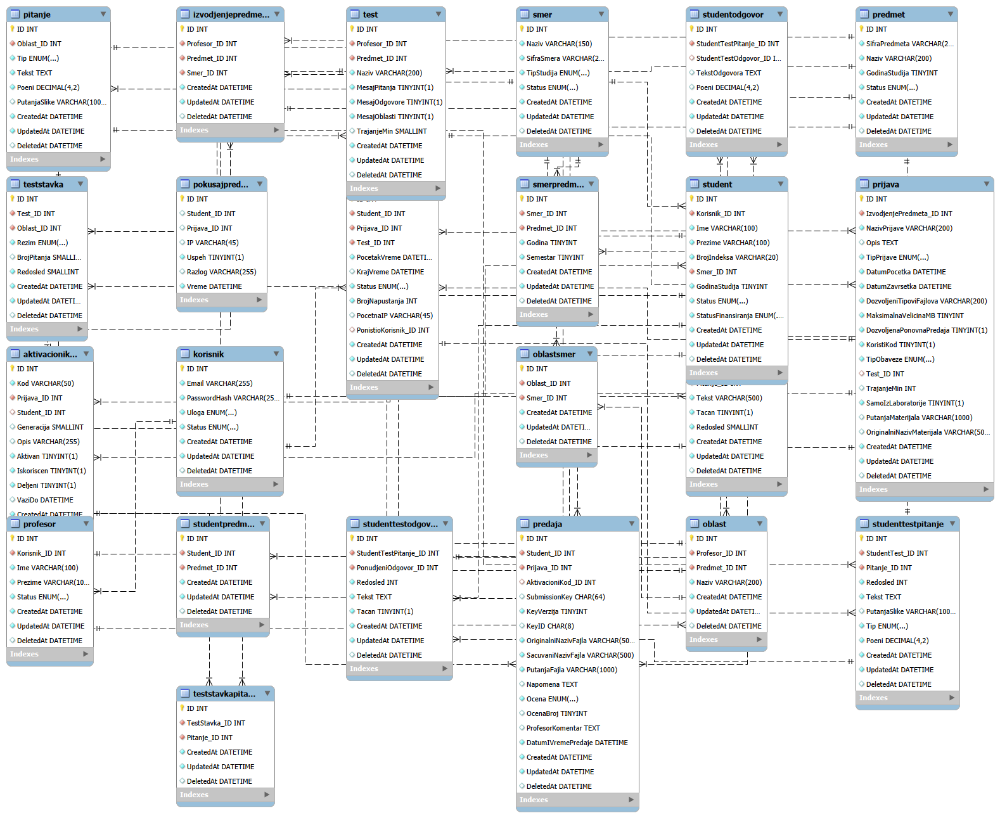

# AIspit: Online Exams and Assignment Submission

  

AIspit (*Sistem za elektronsku predaju radova i organizaciju onlajn ispita*) is the web application I designed and built for my bachelor's thesis, "Design and Development of a Web Application for Organizing Online Exams Using Generative Artificial Intelligence Tools", at the [Academy of Applied Technical and Preschool Studies Niš](https://international.akademijanis.edu.rs/about-us.html) (programme Modern Computer Technologies; defended September 2026).

> **About this repository.** It contains documentation and screenshots only. The application source code is not published, because permission to publish it has not been established. Facts below come from the thesis unless another source is named; they cannot be checked against code here.

**Status:** deployed and publicly accessible ([login page](https://aispit.vtsappsteam.edu.rs/login)), but not currently in active use.

---

## What it does

- **Assignment submission.** Students upload their work for a submission period. Uploads are checked by their leading bytes, not by extension (PDF must start with `%PDF`, ZIP and Office files with `PK`), and stored under a server-generated name. Submissions can require a code that expires; code entry is limited to five attempts per minute per student account. Each submission gets a server timestamp and an HMAC-SHA256 computed with a server-side secret key, so the record can later be shown to be unchanged. (File signatures, the code limit, and HMAC-SHA256 are stated in my defence notes, not in the thesis text.)
- **Administration.** Programmes, courses, teaching assignments, and users; students can be imported from a spreadsheet file (thesis, figure 5.2.4).
- **Online exams.** Professors keep a question bank by topic with closed and open questions and compose tests from sections. Questions are selected in two passes without duplicates, and each student gets their own order. When a student starts, the questions and answers are copied into an immutable record of that attempt. Time is measured only on the server; the browser countdown is informational. Answers are saved during the exam. One attempt per session; a reset by a professor or administrator is logged. Closed questions are graded automatically, open ones by the professor.
- **Leaving the exam.** The exam runs full-screen on a page without navigation. The browser reports when the student leaves full-screen or switches windows; after three departures the attempt ends.

## Users and access

Four roles: administrator, professor (*predavač*), assistant (same rights as a professor, different account role), and student. Accounts are created by an administrator; there is no public registration.

Access is checked on three levels: logged in, correct role, and ownership of the specific record (the check that stops a user reaching someone else's data by changing a number in the URL). Passwords are stored as salted hashes (Werkzeug). The signed session cookie holds only the user ID and role; user data is reloaded from the database on every request.

## Architecture

- Multi-page application: Python and Flask on the server, HTML rendered with Jinja2 (62 templates), one hand-written stylesheet of about 1,200 lines with light and dark themes (no CSS framework; icons from a locally bundled Bootstrap Icons package), plain JavaScript without a build step. Asynchronous requests are used in only three places.
- The application is built in a factory function; routes are split into four modules (blueprints) by role, 106 routes in total.
- MySQL 8 (InnoDB) with hand-written parameterised SQL and no ORM.
- Designed to run in a computer lab without internet access, so all libraries are bundled with the project.

  

## Database

23 tables, 39 foreign keys, 16 unique constraints, 46 secondary indexes, and 3 legacy views not used by the application. The model is in third normal form, with one deliberate exception: the tables that store each exam attempt copy the questions and answers, so a later edit to the question bank cannot change a past result. Nothing is physically deleted (soft delete). Closed sets of values use ENUM.

  

## Testing

The thesis documents 547 server-side checks (Flask test client, 26 groups) and 27 checks that run in a real browser, run after every change.

Every check was first shown to fail when the rule it covers was deliberately broken ("negative verification"). This exposed five checks that passed without testing anything; for example, one passed because both the accepted and the rejected request returned the same status code.

Two defects were missed by the server-side checks:

1. Reported from use: the warning dialog shown when a student left the exam sat inside the part of the page that is blurred and disabled, so it disabled itself, and repeated browser events counted one departure twice. It was fixed, and browser checks were added.
2. Found after development had finished: uploaded files were stored under the static directory and could be downloaded without logging in. The storage was moved and a regression check was added.

These checks were not re-run for this repository, because the source code is not published.

## How AI tools were used

Claude was used to discuss design options and review them; Claude Code wrote routes, model functions, SQL, templates, and automated checks under my direction; Gemini and ChatGPT were used only for the logo and graphics. The running application contains no AI model.

I set the requirements and made the key decisions, among them no ORM, Belgrade wall-clock time as the single time source, soft delete, and immutable exam snapshots. I rejected two proposals from the tool (a many-to-many link between programmes and courses, and storing score totals) and deliberately postponed one decision. Development took six weeks and 110 commits (42 feature, 32 refinement, 19 fix, 17 documentation), more than half of them in the last five days.

## Screenshots

The entity-relationship diagram is the thesis figure. The other screenshots were captured for this repository in November 2026, using demo or sanitised data.

| Screen | File |
|---|---|
| Test builder with sections | `screenshots/test_creator_sections.png` |
| Student exam screen (demo questions) | `screenshots/exam_taking_interface.png` |
| Warning after leaving the exam | `screenshots/exam_violation_modal.png` |
| Assignment upload (sanitised) | `screenshots/assignment_submission_sanitized.png` |
| Professor's submissions list (sanitised) | `screenshots/professor_submissions_view_sanitized.png` |

## Known limitations

- No load testing with many simultaneous users.
- The thesis does not describe the server configuration; see `docs/DEPLOYMENT.md` for what is known.
- Code coverage was not measured.

## Academic details

- Author: Dimitrije Jović
- Mentor: dr Slavimir Stošović
- Committee: dr Nikola Sekulović, dr Dušan Stefanović
- Course: Klijent server sistemi

## Further documentation

The files in `docs/` describe the architecture, database, security, testing, deployment, and AI-assisted development in more detail. Where they go beyond the thesis, they are marked as not verifiable from this repository.
